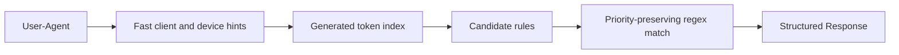

# Device Detector

**Fast, embedded User-Agent detection for Crystal.**

[](https://github.com/creadone/device_detector/releases)
[](https://crystal-lang.org/)
[](LICENSE)

[Русская версия](README.ru.md)

Device Detector turns a raw `User-Agent` string into structured information about the client: browser, operating system, device type, vendor, model, applications, bots, TVs, consoles, cameras, and more.

It is designed for services that need local, predictable detection without a network call or an external database.

- **Broad coverage** — browsers, bots, mobile devices, desktop OSes, apps, libraries, TVs, consoles, cameras, and specialized clients.
- **Self-contained** — rules from [Matomo Device Detector](https://github.com/matomo-org/device-detector) are embedded in the binary at compile time.
- **Two parsing modes** — detailed `full` detection or a faster `lite` bot/mobile path.
- **Parallel-safe** — the request path has no shared writes or global parser lock.
- **Optimized rule lookup** — generated token indexes reduce the number of regular expressions evaluated for the largest rule sets.

> User-Agent detection is heuristic. Treat its output as analytics or routing metadata, not as proof of identity or a security boundary.

## Installation

Add the shard to your `shard.yml`:

```yaml
dependencies:
  device_detector:
    github: creadone/device_detector
    version: ~> 1.5
```

Install dependencies:

```shell
shards install
```

Device Detector 1.5 requires Crystal 1.21 or newer.

## Quick start

```crystal
require "device_detector"

user_agent = "Mozilla/5.0 (Linux; Android 13; Pixel 7 Build/TQ3A) " \
             "AppleWebKit/537.36 (KHTML, like Gecko) Chrome/120.0.0.0 " \
             "Mobile Safari/537.36"

response = DeviceDetector::Detector.new(user_agent).call

response.browser.name    # => "Chrome Mobile"
response.browser.version # => "120.0.0.0"
response.os.name         # => "Android"
response.os.version      # => "13"
response.mobile.vendor   # => "Google"
response.mobile.type     # => "smartphone"
response.mobile.model    # => "Pixel 7"
response.traffic_type    # => "human"
```

That is the complete integration: require the shard, create a detector, and parse the string.

## Command-line interface

Build the standalone executable:

```shell
shards build device-detector --release
```

Parse one User-Agent passed as an argument:

```shell
./bin/device-detector "Mozilla/5.0 (Linux; Android 13; Pixel 7 Build/TQ3A) ..."
```

For batch processing, pass one User-Agent per line on stdin. The command uses the available CPU cores by default; `--workers` sets an explicit upper limit:

```shell
./bin/device-detector --workers 8 < user_agents.txt
```

The output is [JSON Lines](https://jsonlines.org/): one compact JSON object per input line, in the same order as the input.

```json
{"user_agent":"Mozilla/5.0 (...)","traffic_type":"human","browser":{"name":"Chrome Mobile","version":"120.0.0.0"},"browser_engine":{"name":"Blink"},"mobile":{"vendor":"Google","type":"smartphone","model":"Pixel 7"},"os":{"name":"Android","version":"13"}}
```

Each object contains the original `user_agent`, the derived `traffic_type`, and every non-empty section and field produced by the full parser. Empty input lines are ignored. Input can come from positional arguments, stdin, or `-` as the conventional stdin placeholder.

```text
Usage: device-detector [options] [USER_AGENT ...]
       device-detector [options] < user-agents.txt

    -w N, --workers=N    Parse with up to N workers
    -v, --version        Print version
    -h, --help           Show help
```

## Choose a parsing mode

| Mode | Call | Parsers | Best for |
| --- | --- | --- | --- |
| Full | `Detector#call` | All 16 parser groups | Analytics, enrichment, detailed device/client information |
| Lite | `Detector#lite` | Bot and mobile device | Request routing, coarse traffic classification, hot paths |

```crystal
detector = DeviceDetector::Detector.new(user_agent)

full = detector.call # Complete response
lite = detector.lite # Bot and mobile sections only
```

Both methods return `DeviceDetector::Response`. An unfamiliar User-Agent does not raise an error; section and field predicates return `false` when nothing was detected.

## Common recipes

### Separate bots from human traffic

```crystal
response = DeviceDetector::Detector.new(user_agent).call

if response.bot?
  puts "bot: #{response.bot.name}"
else
  puts "human"
end
```

`Response#traffic_type` returns `"bot"` when a bot or an HTTP client library is detected. All other traffic is reported as `"human"`.

```crystal
response.traffic_type # => "bot" | "human"
```

### Route mobile requests

Use the lite parser when bot and mobile detection are all you need:

```crystal
response = DeviceDetector::Detector.new(user_agent).lite

if response.bot?
  route_to_bot_pipeline
elsif response.mobile?
  route_to_mobile_site
else
  route_to_desktop_site
end
```

### Extract analytics dimensions safely

Field accessors have the type `String?`, while predicates also normalize the empty strings returned by unmatched built-in parsers. Use a field predicate when exporting an optional dimension:

```crystal
response = DeviceDetector::Detector.new(user_agent).call
browser = response.browser
mobile = response.mobile

if browser.name?
  puts "Browser: #{browser.name}"
end

if mobile.model?
  puts "Device model: #{mobile.model}"
end
```

### Detect Huawei traffic without a full parse

For a routing decision that only needs to identify Huawei devices:

```crystal
DeviceDetector::Parser::Mobile.prepare_huawei

if DeviceDetector::Parser::Mobile.huawei?(user_agent)
  route_to_huawei_flow
end
```

The classifier uses the same Huawei model rules as the complete mobile parser. Honor rules are evaluated first so Honor-branded devices are not misclassified as Huawei.

### Inspect the raw parser output

```crystal
response = DeviceDetector::Detector.new(user_agent).call
pp response.raw
```

`Response#raw` returns an `Array(Hash(String, Hash(String, String)))`. Prefer the object-style API for application code; raw output is most useful for debugging and generic integrations.

## Response API

Every section provides:

- a predicate such as `response.browser?`;
- an object accessor such as `response.browser`;
- nullable field accessors such as `response.browser.name`;
- field predicates such as `response.browser.name?`.

| Section | Predicate | Available fields |
| --- | --- | --- |
| Bot | `bot?` | `bot.name` |
| Browser | `browser?` | `browser.name`, `browser.version` |
| Browser engine | `browser_engine?` | `browser_engine.name` |
| Camera | `camera?` | `camera.device`, `camera.vendor` |
| Car browser | `car_browser?` | `car_browser.model`, `car_browser.vendor` |
| Console | `console?` | `console.model`, `console.vendor` |
| Feed reader | `feed_reader?` | `feed_reader.name`, `feed_reader.version` |
| HTTP client library | `library?` | `library.name`, `library.version` |
| Media player | `mediaplayer?` | `mediaplayer.name`, `mediaplayer.version` |
| Mobile app | `mobile_app?` | `mobile_app.name`, `mobile_app.version` |
| Mobile device | `mobile?` | `mobile.vendor`, `mobile.type`, `mobile.model` |
| Operating system | `os?` | `os.name`, `os.version` |
| PIM client | `pim?` | `pim.name`, `pim.version` |
| Portable media player | `portable_media_player?` | `portable_media_player.model`, `portable_media_player.vendor` |
| TV | `tv?` | `tv.model`, `tv.vendor` |
| Vendor fragment | `vendorfragment?` | `vendorfragment.vendor` |

Object accessors are safe even when a section was not detected:

```crystal
response.console?       # => false
response.console.model  # => ""
response.console.model? # => false
```

Field accessors return `String?` because a key may be absent. Built-in parser sections generally use an empty string for a known field that was not detected. Use the section or field predicates when presence matters.

The legacy flat API remains available for compatibility:

```crystal
response.browser_name
response.browser_version
response.mobile_device?
response.mobile_device_vendor
response.mobile_device_type
response.mobile_device_model
response.camera_model
```

New code should prefer the object-style API.

## How it works



1. Regex catalogs derived from Matomo Device Detector are embedded into the compiled application. There are no rule files to deploy and no runtime downloads.
2. The rule data is decoded into typed parser structures when the application starts.
3. Bots, browsers, operating systems, and mobile devices use generated token indexes to narrow the candidate set.
4. Candidate rules keep their original YAML priority. When an index cannot make a decision, the parser falls back to the remaining rules to preserve detection semantics.
5. Compiled regular expressions are either read from an immutable prepared snapshot or created in a per-thread fallback cache. Parsing never mutates shared registry state.

The result is deterministic rule-based detection with predictable deployment and no external service dependency.

## Production and parallel parsing

All built-in parser stacks can be called safely from Crystal concurrent and parallel execution contexts.

For latency-sensitive services, prepare the parser set before accepting traffic:

```crystal
require "device_detector"

DeviceDetector.prepare                              # All parsers
# DeviceDetector.prepare(DeviceDetector::Setting::LITE) # Bot + mobile only
```

Preparation compiles the selected regular expressions once and publishes an immutable snapshot shared by all workers. It is an optimization, not a correctness requirement: unprepared expressions use thread-local caches. Repeated and concurrent calls to `prepare` are safe.

Individual parser groups can also be prepared:

```crystal
DeviceDetector::Parser::Bot.prepare
DeviceDetector::Parser::OS.prepare
DeviceDetector::Parser::Mobile.prepare
```

Example batch processing on a dedicated parallel execution context:

```crystal
require "device_detector"
require "fiber/execution_context"

DeviceDetector.prepare(DeviceDetector::Setting::LITE)

user_agents = ["curl/8.0", "Mozilla/5.0 (...)"]
results = Channel(Tuple(String, Bool, Bool)).new(user_agents.size)
context = Fiber::ExecutionContext::Parallel.new("ua-detection", 4)

user_agents.each do |user_agent|
  context.spawn do
    response = DeviceDetector::Detector.new(user_agent).lite
    results.send({user_agent, response.bot?, response.mobile?})
  end
end

user_agents.size.times do
  user_agent, bot, mobile = results.receive
  pp({user_agent: user_agent, bot: bot, mobile: mobile})
end
```

## Performance

Run the included benchmark in release mode:

```shell
crystal run --release bench/raw_response.cr
```

The workload contains 10,000 deterministic, unique User-Agent strings across desktop browsers, Android, iOS, bots, libraries, applications, consoles, TVs, and PIM clients.

Reference result on Apple Silicon arm64 with Crystal 1.21.0, reported as the median of seven release runs:

| Mode | Throughput | Average time per User-Agent |
| --- | ---: | ---: |
| Full | **7,911/s** | ~126 μs |
| Lite | **29,334/s** | ~34 μs |

A separate stress test used a fixed hot set of 12 representative User-Agents—including Android, iOS, desktop, bots, and Huawei—and 100,000 parses. Median throughput across three release runs was:

| Mode | One worker | Four workers | Scaling |
| --- | ---: | ---: | ---: |
| Full | 8,202/s | **21,536/s** | **2.63×** |
| Lite | 23,220/s | **73,317/s** | **3.16×** |

These numbers are a reference point, not a latency guarantee. CPU, architecture, Crystal/LLVM versions, User-Agent distribution, and surrounding application work all affect results. Benchmark your real traffic before making capacity decisions.

## Accuracy and limitations

- User-Agent strings can be missing, malformed, or intentionally spoofed.
- A positive detection is suitable for presentation, analytics, feature routing, and traffic segmentation—not authentication or authorization.
- Unknown fields may return `nil` or an empty string; use section and field predicates instead of assuming every browser or device exposes a model or version.
- Detection quality follows the embedded regex snapshot. Update the catalogs when upstream rules change.
- Client-side feature detection is usually a better choice when behavior depends on a specific browser capability.

## Development

Install dependencies and run the complete local check:

```shell
shards install
shards build device-detector
crystal spec
bin/ameba
crystal tool format --check src spec script bench
```

### Updating detection rules

Regex catalogs live in `src/device_detector/regexes` and are based on [matomo-org/device-detector](https://github.com/matomo-org/device-detector).

```shell
crystal run script/update_regexes.cr
crystal spec
bin/ameba
```

The update script mirrors upstream `regexes/**/*.yml` files and regenerates token indexes under `src/device_detector/regexes/index`. Review and commit the regex and generated-index diffs together.

## Contributing and support

Bug reports, rule corrections, performance investigations, and pull requests are welcome in [GitHub Issues](https://github.com/creadone/device_detector/issues).

For a pull request:

1. Add or update specs when behavior changes.
2. Run the test, lint, and formatting commands above.
3. Include benchmark results when changing a parser hot path or generated index.
4. Explain whether detection priority or compatibility is affected.

## Maintainers and contributors

- [@creadone](https://github.com/creadone) — Sergey Fedorov, creator and maintainer
- [@delef](https://github.com/delef) — Ivan Palamarchuk, response API and performance work
- [@zaycker](https://github.com/zaycker) — Yuriy Zaitsev, parser-order fix

## License

[MIT](LICENSE)
