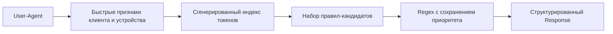

# Device Detector

**Быстрое локальное определение устройств и клиентов по User-Agent для Crystal.**

[](https://github.com/creadone/device_detector/releases)
[](https://crystal-lang.org/)
[](LICENSE)

[English version](README.md)

Device Detector превращает строку `User-Agent` в структурированную информацию о клиенте: браузер, операционная система, тип устройства, производитель, модель, приложение, бот, телевизор, консоль, камера и другие категории.

Библиотека предназначена для сервисов, которым нужно локальное и предсказуемое определение клиента без сетевых запросов и внешней базы данных.

- **Широкое покрытие** — браузеры, боты, мобильные устройства, настольные ОС, приложения, HTTP-библиотеки, телевизоры, консоли, камеры и специализированные клиенты.
- **Автономная работа** — правила из [Matomo Device Detector](https://github.com/matomo-org/device-detector) встраиваются в бинарный файл на этапе компиляции.
- **Два режима** — подробный разбор `full` и ускоренный путь `lite` для ботов и мобильных устройств.
- **Безопасный параллелизм** — на пути обработки запроса нет записи в общее состояние и глобальной блокировки парсера.
- **Оптимизированный поиск правил** — сгенерированные индексы токенов сокращают число проверяемых регулярных выражений в самых крупных наборах правил.

> Определение по User-Agent всегда эвристическое. Используйте результат как метаданные для аналитики и маршрутизации, но не как подтверждение личности или границу безопасности.

## Установка

Добавьте shard в `shard.yml`:

```yaml
dependencies:
  device_detector:
    github: creadone/device_detector
    version: ~> 1.5
```

Установите зависимости:

```shell
shards install
```

Для Device Detector 1.5 требуется Crystal 1.21 или новее.

## Быстрый старт

```crystal
require "device_detector"

user_agent = "Mozilla/5.0 (Linux; Android 13; Pixel 7 Build/TQ3A) " \
             "AppleWebKit/537.36 (KHTML, like Gecko) Chrome/120.0.0.0 " \
             "Mobile Safari/537.36"

response = DeviceDetector::Detector.new(user_agent).call

response.browser.name    # => "Chrome Mobile"
response.browser.version # => "120.0.0.0"
response.os.name         # => "Android"
response.os.version      # => "13"
response.mobile.vendor   # => "Google"
response.mobile.type     # => "smartphone"
response.mobile.model    # => "Pixel 7"
response.traffic_type    # => "human"
```

Это вся интеграция: подключите shard, создайте детектор и передайте ему строку.

## Консольная утилита

Соберите отдельный исполняемый файл:

```shell
shards build device-detector --release
```

Передайте один User-Agent аргументом:

```shell
./bin/device-detector "Mozilla/5.0 (Linux; Android 13; Pixel 7 Build/TQ3A) ..."
```

Для пакетной обработки передайте по одному User-Agent в каждой строке stdin. По умолчанию команда использует доступные ядра процессора; `--workers` задает явное верхнее ограничение:

```shell
./bin/device-detector --workers 8 < user_agents.txt
```

Результат возвращается в формате [JSON Lines](https://jsonlines.org/): один компактный JSON-объект на входную строку с сохранением исходного порядка.

```json
{"user_agent":"Mozilla/5.0 (...)","traffic_type":"human","browser":{"name":"Chrome Mobile","version":"120.0.0.0"},"browser_engine":{"name":"Blink"},"mobile":{"vendor":"Google","type":"smartphone","model":"Pixel 7"},"os":{"name":"Android","version":"13"}}
```

Каждый объект содержит исходный `user_agent`, вычисленный `traffic_type` и все непустые секции и поля полного парсера. Пустые входные строки игнорируются. Данные можно передать позиционными аргументами, через stdin или через `-` — стандартное обозначение stdin.

```text
Usage: device-detector [options] [USER_AGENT ...]
       device-detector [options] < user-agents.txt

    -w N, --workers=N    Parse with up to N workers
    -v, --version        Print version
    -h, --help           Show help
```

## Выбор режима парсинга

| Режим | Вызов | Набор парсеров | Когда использовать |
| --- | --- | --- | --- |
| Full | `Detector#call` | Все 16 групп парсеров | Аналитика, обогащение данных, подробная информация об устройстве и клиенте |
| Lite | `Detector#lite` | Бот и мобильное устройство | Маршрутизация запросов, грубая классификация трафика, горячие участки кода |

```crystal
detector = DeviceDetector::Detector.new(user_agent)

full = detector.call # Полный ответ
lite = detector.lite # Только секции bot и mobile
```

Оба метода возвращают `DeviceDetector::Response`. Незнакомый User-Agent не приводит к исключению; предикаты секций и полей возвращают `false`, если ничего не обнаружено.

## Популярные сценарии

### Отделить ботов от людей

```crystal
response = DeviceDetector::Detector.new(user_agent).call

if response.bot?
  puts "bot: #{response.bot.name}"
else
  puts "human"
end
```

`Response#traffic_type` возвращает `"bot"`, если обнаружен бот или HTTP-клиентская библиотека. Весь остальной трафик получает значение `"human"`.

```crystal
response.traffic_type # => "bot" | "human"
```

### Маршрутизировать мобильные запросы

Если нужны только бот и мобильное устройство, используйте lite-парсер:

```crystal
response = DeviceDetector::Detector.new(user_agent).lite

if response.bot?
  route_to_bot_pipeline
elsif response.mobile?
  route_to_mobile_site
else
  route_to_desktop_site
end
```

### Безопасно извлечь данные для аналитики

Методы полей имеют тип `String?`, а предикаты также нормализуют пустые строки, которые возвращают встроенные парсеры при отсутствии совпадения. Для необязательного аналитического измерения используйте предикат поля:

```crystal
response = DeviceDetector::Detector.new(user_agent).call
browser = response.browser
mobile = response.mobile

if browser.name?
  puts "Browser: #{browser.name}"
end

if mobile.model?
  puts "Device model: #{mobile.model}"
end
```

### Определить Huawei без полного разбора

Если для маршрутизации нужно только определить устройство Huawei:

```crystal
DeviceDetector::Parser::Mobile.prepare_huawei

if DeviceDetector::Parser::Mobile.huawei?(user_agent)
  route_to_huawei_flow
end
```

Классификатор использует те же правила моделей Huawei, что и полный мобильный парсер. Правила Honor проверяются первыми, поэтому устройства под брендом Honor не классифицируются как Huawei.

### Посмотреть исходный ответ парсеров

```crystal
response = DeviceDetector::Detector.new(user_agent).call
pp response.raw
```

`Response#raw` возвращает `Array(Hash(String, Hash(String, String)))`. В прикладном коде лучше использовать объектный API; исходный ответ удобен для отладки и универсальных интеграций.

## API ответа

Каждая секция предоставляет:

- предикат, например `response.browser?`;
- объектный метод доступа, например `response.browser`;
- необязательные поля типа `String?`, например `response.browser.name`;
- предикаты полей, например `response.browser.name?`.

| Секция | Предикат | Доступные поля |
| --- | --- | --- |
| Бот | `bot?` | `bot.name` |
| Браузер | `browser?` | `browser.name`, `browser.version` |
| Движок браузера | `browser_engine?` | `browser_engine.name` |
| Камера | `camera?` | `camera.device`, `camera.vendor` |
| Автомобильный браузер | `car_browser?` | `car_browser.model`, `car_browser.vendor` |
| Консоль | `console?` | `console.model`, `console.vendor` |
| RSS/Atom-клиент | `feed_reader?` | `feed_reader.name`, `feed_reader.version` |
| HTTP-клиентская библиотека | `library?` | `library.name`, `library.version` |
| Медиаплеер | `mediaplayer?` | `mediaplayer.name`, `mediaplayer.version` |
| Мобильное приложение | `mobile_app?` | `mobile_app.name`, `mobile_app.version` |
| Мобильное устройство | `mobile?` | `mobile.vendor`, `mobile.type`, `mobile.model` |
| Операционная система | `os?` | `os.name`, `os.version` |
| PIM-клиент | `pim?` | `pim.name`, `pim.version` |
| Портативный медиаплеер | `portable_media_player?` | `portable_media_player.model`, `portable_media_player.vendor` |
| Телевизор | `tv?` | `tv.model`, `tv.vendor` |
| Фрагмент производителя | `vendorfragment?` | `vendorfragment.vendor` |

Объектные методы доступа безопасны, даже если секция не обнаружена:

```crystal
response.console?       # => false
response.console.model  # => ""
response.console.model? # => false
```

Методы полей возвращают `String?`, потому что ключ может отсутствовать. Встроенные секции парсеров обычно используют пустую строку для известного, но не определившегося поля. Если важно наличие значения, проверяйте предикат секции или поля.

Старый плоский API сохранен для обратной совместимости:

```crystal
response.browser_name
response.browser_version
response.mobile_device?
response.mobile_device_vendor
response.mobile_device_type
response.mobile_device_model
response.camera_model
```

В новом коде рекомендуется объектный API.

## Как это работает



1. Каталоги регулярных выражений на основе Matomo Device Detector встраиваются в скомпилированное приложение. Не нужно разворачивать файлы правил или загружать их во время работы.
2. При запуске приложения данные правил преобразуются в типизированные структуры парсеров.
3. Парсеры ботов, браузеров, операционных систем и мобильных устройств используют сгенерированные индексы токенов, чтобы сократить список кандидатов.
4. Правила-кандидаты сохраняют исходный приоритет из YAML. Если индекс не позволяет принять решение, парсер проверяет оставшиеся правила и сохраняет прежнюю семантику определения.
5. Скомпилированные регулярные выражения читаются из общего неизменяемого снимка либо создаются в локальном кэше каждого потока. Парсинг не изменяет состояние общего реестра.

В результате получается детерминированное определение по правилам, предсказуемое развертывание и отсутствие зависимости от внешнего сервиса.

## Продакшен и параллельный парсинг

Все встроенные наборы парсеров можно безопасно вызывать из concurrent и parallel execution contexts Crystal.

В чувствительном к задержкам сервисе подготовьте нужный набор до начала приема трафика:

```crystal
require "device_detector"

DeviceDetector.prepare                              # Все парсеры
# DeviceDetector.prepare(DeviceDetector::Setting::LITE) # Только bot + mobile
```

Подготовка один раз компилирует выбранные регулярные выражения и публикует общий для всех рабочих потоков неизменяемый снимок. Это оптимизация, а не требование корректности: неподготовленные выражения используют локальные кэши потоков. Повторные и конкурентные вызовы `prepare` безопасны.

Отдельные группы парсеров тоже можно подготовить заранее:

```crystal
DeviceDetector::Parser::Bot.prepare
DeviceDetector::Parser::OS.prepare
DeviceDetector::Parser::Mobile.prepare
```

Пример пакетной обработки в отдельном параллельном execution context:

```crystal
require "device_detector"
require "fiber/execution_context"

DeviceDetector.prepare(DeviceDetector::Setting::LITE)

user_agents = ["curl/8.0", "Mozilla/5.0 (...)"]
results = Channel(Tuple(String, Bool, Bool)).new(user_agents.size)
context = Fiber::ExecutionContext::Parallel.new("ua-detection", 4)

user_agents.each do |user_agent|
  context.spawn do
    response = DeviceDetector::Detector.new(user_agent).lite
    results.send({user_agent, response.bot?, response.mobile?})
  end
end

user_agents.size.times do
  user_agent, bot, mobile = results.receive
  pp({user_agent: user_agent, bot: bot, mobile: mobile})
end
```

## Производительность

Запустите встроенный benchmark в release-режиме:

```shell
crystal run --release bench/raw_response.cr
```

Нагрузка содержит 10 000 детерминированных уникальных строк User-Agent: настольные браузеры, Android, iOS, боты, библиотеки, приложения, консоли, телевизоры и PIM-клиенты.

Результат на Apple Silicon arm64 и Crystal 1.21.0 — медиана семи запусков release-сборки:

| Режим | Пропускная способность | Среднее время на User-Agent |
| --- | ---: | ---: |
| Full | **7 911/s** | ~126 μs |
| Lite | **29 334/s** | ~34 μs |

В отдельном стресс-тесте использовался фиксированный горячий набор из 12 характерных User-Agent, включая Android, iOS, настольные системы, ботов и Huawei, и 100 000 разборов. Медианная пропускная способность трех запусков release-сборки составила:

| Режим | Один рабочий поток | Четыре рабочих потока | Масштабирование |
| --- | ---: | ---: | ---: |
| Full | 8 202/s | **21 536/s** | **2,63×** |
| Lite | 23 220/s | **73 317/s** | **3,16×** |

Эти значения — ориентир, а не гарантия задержки. На результат влияют процессор, архитектура, версии Crystal и LLVM, распределение User-Agent и остальная работа приложения. Перед расчетом мощности измерьте производительность на своем реальном трафике.

## Точность и ограничения

- User-Agent может отсутствовать, быть поврежденным или намеренно подделанным.
- Результат подходит для отображения, аналитики, маршрутизации возможностей и сегментации трафика, но не для аутентификации или авторизации.
- Неизвестные поля могут возвращать `nil` или пустую строку; используйте предикаты секций и полей и не рассчитывайте, что у каждого браузера или устройства определятся модель и версия.
- Качество определения зависит от встроенного снимка регулярных выражений. Обновляйте каталоги вслед за исходными правилами Matomo.
- Если поведение зависит от конкретной возможности браузера, обычно надежнее проверить эту возможность на стороне клиента.

## Разработка

Установите зависимости и выполните полную локальную проверку:

```shell
shards install
shards build device-detector
crystal spec
bin/ameba
crystal tool format --check src spec script bench
```

### Обновление правил определения

Каталоги регулярных выражений находятся в `src/device_detector/regexes` и основаны на [matomo-org/device-detector](https://github.com/matomo-org/device-detector).

```shell
crystal run script/update_regexes.cr
crystal spec
bin/ameba
```

Скрипт зеркалирует исходные файлы `regexes/**/*.yml` и пересоздает индексы токенов в `src/device_detector/regexes/index`. Изменения регулярных выражений и сгенерированных индексов нужно проверять и коммитить вместе.

## Участие в разработке и поддержка

Сообщения об ошибках, исправления правил, исследования производительности и pull requests приветствуются в [GitHub Issues](https://github.com/creadone/device_detector/issues).

Перед pull request:

1. Добавьте или обновите тесты, если меняется поведение.
2. Запустите тесты, линтер и проверку форматирования из раздела выше.
3. Приложите результаты бенчмарка, если меняется горячий путь парсера или сгенерированный индекс.
4. Укажите, влияет ли изменение на приоритет определения или обратную совместимость.

## Сопровождение и участники

- [@creadone](https://github.com/creadone) — Сергей Федоров, автор и сопровождающий
- [@delef](https://github.com/delef) — Иван Паламарчук, API ответа и оптимизация производительности
- [@zaycker](https://github.com/zaycker) — Юрий Зайцев, исправление порядка парсеров

## Лицензия

[MIT](LICENSE)
